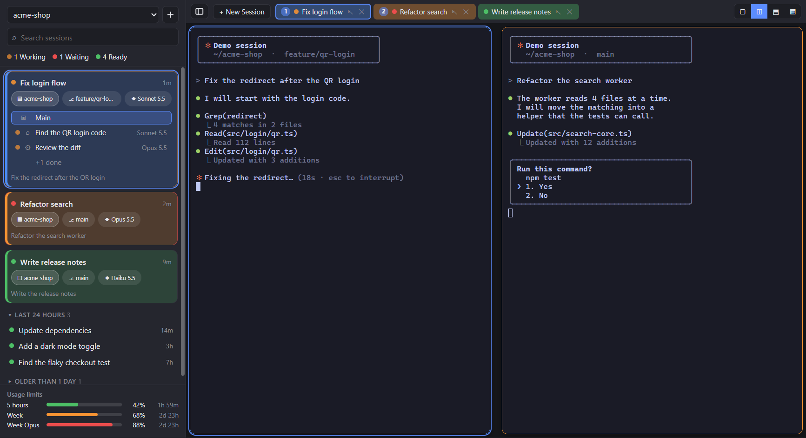

# Hive

Hive is a desktop app for working with many Claude Code sessions at once. It lists the sessions of a folder on the left and runs the real `claude` command in terminal panes on the right. It runs on macOS, Windows and Linux.

The picture shows demo data.

This is the Electron version. The earlier native macOS version in Swift is kept in the git tag `swift-v1`.

## Features

Hive shows all your sessions with their live status, searches the conversations, puts up to four terminals side by side, can move a session to its own window, and sends a notification when a session needs you. `docs/FEATURES.md` describes every feature, the keys and the placement rules, with pictures.

## License

Hive uses the MIT license. See the file `LICENSE`. You can use, copy, change and share the code, also for commercial work, if you keep the copyright line and the license text. The software has no warranty.

Hive is not affiliated with Anthropic. It runs the `claude` command of Claude Code, which you install and license on your own. Claude is a trademark of Anthropic.

## More documentation

- `docs/FEATURES.md` describes every product feature, the keys and the placement rules for panes and tabs.
- `docs/TECH-STACK.md` describes the stack, the architecture, the data formats, the tests and the decisions.
- `CLAUDE.md` holds the working rules for agents and people who change the code.

## Download

The installers for Windows and macOS are on the Releases page of this repository. A release has them only after the maintainer builds them, so a new minor or patch release can come without files for a while.

- Windows: run `Hive-<version>-win-x64.exe`. The installer is not signed, so Windows SmartScreen warns about an unknown publisher. Choose "More info", then "Run anyway".
- macOS: open the `.dmg` for your Mac and drag Hive to Applications. Use `arm64` for Apple Silicon and `x64` for an Intel Mac. The app is not notarized. The first time, open it with a right click and "Open".

## Requirements

- Node.js 22.18 or later, to build and run from source. The scripts in `scripts/` run TypeScript directly.
- The `claude` command from Claude Code, on the path of your login shell.

## Develop

    npm install
    npm run dev

`npm install` also sets up a pre-commit hook that runs the lint on the files that you commit.

`npm run dev` has hot reload for the interface. When you change React or CSS code, the window updates at once. When you change a file that holds the state of the app, the page reloads. After a reload the tabs come back, and they attach again to the Claude processes that still run, so no session is lost.

`npm run dev:watch` also restarts the whole app after a change in the main process or the preload script. A restart ends all terminals. Do not use it for Hive inside Hive, because it ends your own session.

Other commands:

- `npm test` runs the unit tests.
- `npm run test:e2e` starts the real app and runs the end-to-end tests. The app windows open on your screen and take the focus.
- `npm run test:e2e:docker` runs the same tests in a Docker container on a virtual screen, so nothing opens on your desktop. The first run builds the image and takes a few minutes.
- `npm run typecheck` checks the types.
- `npm run lint` checks the code and the style. `npm run lint:fix` formats the code and applies the safe fixes.
- `npm run dist` builds an installer for the system you are on. The version is the next release version with a draft mark, for example `2.1.0-draft.3`, so a local file is never mistaken for a release.

Each merge to `main` makes a new release with a version and a tag. The commit type decides the version: `feat` gives a minor version, `feat!:` or a `BREAKING CHANGE:` line gives a major version, and every other type gives a patch version. The release has notes and no installers. A major release gets them at once. For any other release, the maintainer builds them on demand with the workflow "Installers" (Actions tab, "Run workflow"), which adds them to the release. Squash merge the pull requests, and give each one a title in the form `type: description`. `docs/TECH-STACK.md`, section 14, describes it.

The renderer is React with `xterm.js`. The main process runs the terminals with `node-pty`, reads the session files and sends notifications. Run `npx electron scripts/make-icon.cjs` to draw the icon again.

## Contribute

The branch `main` is protected. A change goes in a branch and reaches `main` through a pull request.

- Give the pull request a title in the form `type: description`. The types are `feat`, `fix`, `perf`, `refactor`, `docs`, `test`, `chore`, `ci`, `build`, `style` and `revert`. Squash merge the pull request. The type chooses the version.
- Bring `main` into the branch before you merge. The checks must pass on that result.
- Run `npm run typecheck`, `npm run lint` and `npm test` before you push. A pre-commit hook runs the lint on the files that you commit.

## Status hooks and usage limits

Hive reads session status and usage limits from files that Claude Code writes through hooks and the status line. Click "Install hooks" in the left panel once. Hive then does the following:

- It copies two small Node scripts to `~/.claude-sessions`.
- It adds hooks to `~/.claude/settings.json` and wraps your status line command. The original status line command still runs with the same input.
- It saves a backup of the settings file as `settings.json.bak-hive`, and it replaces the hooks of the older Python version. You can click the button again safely.

Without the hooks, every session shows as ready and the usage bars stay empty.

## How it works

- Sessions come from `~/.claude/projects/<folder>/*.jsonl`. Set `CLAUDE_CONFIG_DIR` to use another Claude Code folder.
- A new session starts with `claude --session-id <id>`. An old one starts with `claude --resume <id>`.
- Each session keeps running during the life of its tab, also while no pane shows it.

## Test the window

Set `HIVE_DEBUG=1` to get `window.__hive` in the page. Set `HIVE_PTY_COMMAND` to run a harmless command instead of Claude. Set `HIVE_SCREENSHOT=<file.png>` to save a picture of the window and quit, with `HIVE_EXEC_JS` to run a script first.

## Windows

The CI runs the automated tests on Windows. The installer workflow builds the installer and starts the packaged app once. Terminals use `cmd.exe`, and the session folder names follow the rule Claude Code uses for Windows paths.
